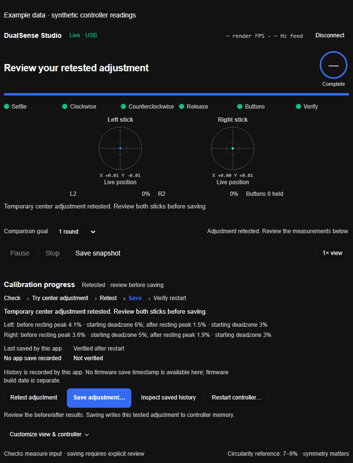

# DualSense Studio

A local toolkit for measuring DualSense stick input, reviewing calibration, and controlling temporary adaptive-trigger and light-bar effects. This fork keeps the upstream browser apps and CLI, and adds MCP coaching plus an optional live card.

*Illustrative synthetic data; this is not a live controller reading.*

[Upstream project](https://github.com/Sufxx/dualsense-doctor) · [MCP coaching](mcp/COACHING.md) · [Reviewed calibration](mcp/REVIEWED-CALIBRATION.md) · [Optional T3 card](mcp/T3-INTEGRATION.md) · [MIT license](LICENSE)

## ✨ Features

- **Browser apps:** inspect live sticks, run drift and range diagnostics, and adjust adaptive triggers or the light bar with WebHID.
- **CLI tools:** sample and monitor sticks with `dsdoctor.py`, or apply temporary trigger effects with `triggers.py`.
- **MCP coaching:** capture guided, logged measurements; read saved reports; and compare up to ten compatible rounds. The optional card supports 1, 3, or 5-round targets. Game deadzone values are unapplied recommendations.
- **Optional T3 live card:** view input and coaching progress, use an evidence-based checklist, create a PNG summary, and explicitly apply temporary effects. Feed and display rates are measured.

Measurement, temporary calibration, and saved controller calibration are separate actions. Read the calibration guide before using calibration controls.

## 🧭 Calibration lifecycle

The optional live-coach calibration workflow is explicit and USB-only for a standard DualSense (not Edge), identified by its factory serial:

1. **Check** the controller state and complete a baseline measurement.
2. **Trial** a temporary center adjustment after a three-second hands-off countdown. This changes the controller's current working calibration state; it is not a software-only display filter and does not save to permanent calibration memory.
3. **Retest** the same controller in the same session with a full measurement.
4. **Save** only after reviewing the retest and explicitly approving the exact candidate. This unlocks and relocks NVS without issuing center or range calibration commands.
5. **Restart and verify** only after the owner actually power-cycles the controller and confirms it. The check reads back the expected values.

Trial, save, and reboot each require an explicit action. Restarting before saving discards the temporary trial. A save acknowledgement is not proof of persistence: the app records a local receipt, and no firmware save timestamp is available through this workflow. The workflow does not guarantee zero drift or repair worn components.

The existing gated `recalibrate_center` command is unchanged. When enabled with `DUALSENSE_MCP_ALLOW_CALIBRATION=1`, it performs its own center recalibration and save in one operation. It is not a save-only step for the reviewed candidate. Generic measurement tools do not write calibration.

**Qualification:** automated hardware-free checks only. No physical trial, save, restart, or readback has been performed; independent review and controlled hardware qualification remain pending.

## 🖥️ Browser apps

Use Chrome or Edge and connect a controller over a supported transport. From the repository root:

~~~sh
./serve.sh
~~~

Open the local address printed by the script. The Studio is at `/studio.html` and the diagnostic page at `/index.html`. Browser and transport support vary by operating system; see the [upstream instructions](https://github.com/Sufxx/dualsense-doctor).

## 🔌 CLI

The Python tools use the system HIDAPI library; installation details depend on the operating system.

~~~sh
python3 dsdoctor.py
python3 dsdoctor.py --monitor 10
python3 triggers.py
~~~

`dsdoctor.py` samples or monitors input by default. Its legacy `--fix` option recalibrates and writes controller memory over USB; do not use it as the reviewed-candidate save step. Trigger effects are temporary and can be replaced by a game or reset on power-off.

## 🤖 MCP server

Requires Node.js 20 or newer. From `mcp/`, install dependencies:

~~~sh
npm ci
~~~

Register with Claude Code, replacing the example with the repository's absolute path:

~~~sh
claude mcp add dualsense -- node /absolute/path/to/dualsense-doctor/mcp/server.js
~~~

The MCP server uses stdio. Measurement tools read controller input and save local session evidence. `show_live_coach` prepares the optional card for a compatible T3 client; calibration controls are separate explicit actions on `live_coach_control`.

Run hardware-free checks from `mcp/`:

~~~sh
npm test
npm run smoke
~~~

Automated checks do not establish physical accuracy or qualify controller writes.

## 🔒 Privacy and safety

Session reports and calibration receipts stay local. Keep session directories, generated card runtime files, and the local capability private. The optional card uses an authenticated loopback service; the core MCP connection uses stdio.

Effects are sent only after an explicit Apply action. A sent command does not confirm the physical result; games or a power cycle can replace it. Disconnect the live card before using another HID tool that needs exclusive controller access.

## 🙏 Credits

The on-controller stick recalibration protocol (NVS unlock / calibrate / flash over HID) was reverse-engineered by **Paolo "the_al"** and the **[dualshock-tools](https://github.com/dualshock-tools/dualshock-tools.github.io)** project (MIT). The original project independently implemented the protocol; this fork adds coaching and reviewed workflow layers. Thanks to that work.

The upstream browser apps and CLI remain part of this project. See the [upstream repository](https://github.com/Sufxx/dualsense-doctor) and [LICENSE](LICENSE).